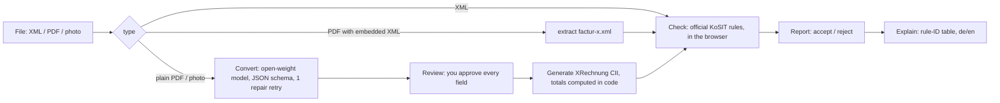

# E-Rechnung-Check

[](https://github.com/syedaayanahmed2001/e-rechnung-check/actions/workflows/ci.yml)

German businesses now have to receive structured e-invoices, and soon have to send them. The
official validator says *that* an invoice is wrong, but rarely what to do about it, and a plain PDF
invoice is not an e-invoice at all.

<!-- demo gif / live link goes here -->

E-Rechnung-Check does four things:

1. **Check** an XRechnung (UBL or CII XML) or a ZUGFeRD / Factur-X PDF with the **official KoSIT
   rules**. The check runs in your browser, so the invoice never leaves your device.
2. **Explain** every finding in plain German or English: what the rule means, the usual cause, the
   fix, and where in the XML it applies.
3. **Convert** a plain PDF or a photo of an invoice into a valid XRechnung. An open-weight model
   reads the fields, and you approve each one.
4. **Measure** how well that extraction works, field by field, against the XML that ZUGFeRD PDFs
   already embed.

## Why now

The dates below come from the Federal Ministry of Finance (BMF) FAQ on the e-invoice, question 11,
checked on 2026-11-22.

| Since / from | What applies to domestic B2B invoices |
|---|---|
| 1 Jan 2025 | Every business must be able to **receive** e-invoices (an e-mail inbox is enough). |
| until 31 Dec 2026 | Every issuer may still send paper or (with consent) PDF invoices. |
| **1 Jan 2027** | Issuers with **previous-year turnover above €800,000** must **send** e-invoices. |
| **1 Jan 2028** | **Every** issuer must send e-invoices. EDI procedures that are not EN 16931 e-invoices also end. |

## How it works



- **Check:** the official KoSIT validator configuration for XRechnung 3.0.2 (release 2026-08-31) runs
  unchanged. Its Schematron XSLT is compiled once to SaxonJS's SEF format. The XML Schema runs in
  libxml2 compiled to WebAssembly. Scenario selection reads the official `scenarios.xml`.
- **Proof it matches the official validator:** CI runs the KoSIT **Java** validator 1.6.3 and this
  JavaScript validator on the same files and fails on any difference. That covers the scenario,
  the verdict, every step, and every rule message with its level, location and text. **Result: 580
  of 580 files identical.** The files are the 86 official test-suite invoices, 427 generated faulty
  variants, 12 synthetic invoices and 55 community samples.
- **One documented adjustment:** SaxonJS stores `xs:integer` as a floating-point number. The official
  IBAN check (BR-DE-19) computes `xs:integer(<24 digits>) mod 97`, so SaxonJS got it wrong for some
  valid IBANs. The parity job found this. The official file is not edited: a generated wrapper
  imports it and overrides that one function with `xs:decimal`, which gives exactly the same result
  for integers. The build fails if KoSIT ever changes the function (`scripts/rules/shims.ts`).

## AI only where it is needed

| Step | AI? | What decides |
|---|---|---|
| Check | **No** | The official KoSIT rules (XSD, EN 16931 Schematron, XRechnung Schematron) |
| Explain | **No** | 114 hand-written explanations keyed by official rule ID, shown next to the official message. Anything else shows the official text, clearly labelled |
| Convert | **Yes**, open-weight models only | The model proposes values with the source snippet for each. You approve every field. Totals and VAT are computed in code. The result goes back through Check |
| Measure | Measures the AI | The XML embedded in ZUGFeRD PDFs is the ground truth |

| Mode | Text model | Image model | Where it runs |
|---|---|---|---|
| Demo | `openai/gpt-oss-120b` | `qwen/qwen3.8-27b` (Groq preview) | Groq free tier (key on the server only) |
| Private | `qwen3:4b` | `granite3.2-vision:2b` | Your machine, via Ollama |
| No key | recorded outputs | recorded outputs | Replays stored runs and never invents an answer |

All four models are Apache-2.0 open weights. No paid API is used.

## Run it

```bash
npm install
npm run rules        # download pinned KoSIT artefacts + SaxonJS (SHA-256 checked), compile rules
npm run dev          # http://localhost:3300
```

Copy `.env.example` to `.env.local` and set `GROQ_API_KEY` for live demo mode. Without a key,
Convert works on the bundled sample using recorded output.

### Private mode (nothing leaves your machine)

```bash
# 1. Install Ollama (https://ollama.com), then pull the two small models:
ollama pull qwen3:4b
ollama pull granite3.2-vision:2b
# 2. Point the app at it:
echo "ERC_PROVIDER=ollama" >> .env.local
npm run dev
```

Check always runs in the browser. In private mode, Convert's model call goes to `127.0.0.1:11434`
too.

### Tests

```bash
npm test                                # vitest: check, explain, convert, i18n
npm run parity                          # Java vs JS on the full corpus (needs Java 17+)
PW_CHANNEL=msedge npx playwright test   # browser tests incl. axe (or PW_CHANNEL=chrome), after npm run build
cd eval && pip install -e ".[dev]" && pytest
```

## Eval

`python -m erc_eval run` scores recorded extractions against the XML embedded in the PDFs. Amounts
must match to the cent, dates as ISO dates, VAT IDs and IBANs after normalisation (with a mod-97
check), and text after Unicode and whitespace normalisation. A value predicted where the invoice
has none counts as a hallucination. CI runs this on recorded outputs with the network blocked.

| Corpus | Extractor | Docs | Field accuracy (fields present) | Hallucinated fields | Schema valid | Latency p50 |
|---|---|---|---|---|---|---|
| synthetic (12 own invoices, 3 layouts) | regex baseline, no AI | 12 | 100 % | 0 | 100 % | 0 ms |
| ZUGFeRD community samples (26 PDFs, fetched) | regex baseline, no AI | 26 | 14.2 % | 3 | 100 % | 0 ms |
| both | `qwen3:4b` (local, Ollama) | – | **not recorded yet** | – | – | – |
| both | `openai/gpt-oss-120b` (Groq) | – | **not recorded yet** | – | – | – |

The baseline was written against the synthetic layouts, so 100 % there only shows that templates
work on the templates they were written for. 14.2 % on unseen layouts is why a model is used at all.
Model rows stay empty until real runs are recorded:
`python -m erc_eval record --provider ollama` (local) or
`GROQ_API_KEY=… python -m erc_eval record --provider groq`. Numbers are never estimated.
Full output: [`eval/results/latest.md`](eval/results/latest.md).

## How this was built: spec first

The project was specified before any product code was written. That spec has numbered,
testable requirements (CHECK, EXPL, CONV, EVAL, UI, OPS). A time-boxed feasibility spike then
answered the hosting question: can the official rules run in JavaScript with full parity? Every
test carries its requirement ID, and each phase was verified against its IDs. The public spec,
including the spike result, is in **[docs/SPEC.md](docs/SPEC.md)**.

## Sources

- BMF: [Fragen und Antworten zur Einführung der obligatorischen E-Rechnung](https://www.bundesfinanzministerium.de/Content/DE/FAQ/e-rechnung.html) (question 11, transition rules)
- KoSIT: [XRechnung](https://xeinkauf.de/xrechnung/), [validator](https://github.com/itplr-kosit/validator), [validator configuration](https://github.com/itplr-kosit/validator-configuration-xrechnung), [test suite](https://github.com/itplr-kosit/xrechnung-testsuite)
- CEN: EN 16931-1:2017 (semantic data model) and the [EN 16931 validation artefacts](https://github.com/ConnectingEurope/eInvoicing-EN16931)
- FeRD: [ZUGFeRD](https://www.ferd-net.de/). Community sample corpus: [ZUGFeRD/corpus](https://github.com/ZUGFeRD/corpus)

## Limitations

- **Not tax advice.** The rules check structure, code lists and arithmetic, not whether an
  invoice is correct under tax law.
- Rules covered: the KoSIT XRechnung 3.0.2 configuration (XRechnung, its Extension and CVD, and
  plain EN 16931 in UBL and CII). ZUGFeRD profiles below EN 16931 (MINIMUM, BASIC WL) match no
  scenario and are rejected, exactly as the official validator does.
- Parity is proven on the corpus above. Rules that never fire in it are not parity-tested. The
  official test suite contains only valid invoices, so the faulty cases are generated.
- XML Schema messages are worded by libxml2, not Xerces. The verdict matches, the wording differs.
- The explanations are author-written drafts from the official rule text and have not been reviewed
  by a tax adviser.
- Convert writes XRechnung in CII syntax with categories S, Z, E and AE. It reads the first page
  only for images and scans, and it does not produce a PDF/A-3 hybrid.
- SaxonJS is free of charge but **not open source** (Saxonica licence, reproduced in
  [THIRD_PARTY_NOTICES.md](THIRD_PARTY_NOTICES.md)). If its terms change, the fallback is the
  official Java validator in a container. The `Validator` interface and the report parser already
  support that.

## Licence

MIT © Syed Aayan Ahmed. Third-party rule files, schemas, the SaxonJS runtime and sample corpora keep
their own licences. See [THIRD_PARTY_NOTICES.md](THIRD_PARTY_NOTICES.md).
