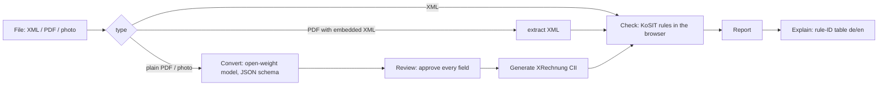

# E-Rechnung-Check: specification

This is the public copy of the spec the project was built from. The working planning files
(per-phase spec, plan, summary, verification) stay local. This document holds the parts that matter
to a reader: what the tool must do, how each requirement is proven, and the decisions behind it.

## 1. Problem

German businesses must be able to receive structured e-invoices since 1 January 2025. Issuers with
a previous-year turnover above €800,000 must send them from 1 January 2027, and every domestic B2B
issuer from 1 January 2028 (BMF FAQ on the e-invoice, question 11, checked 2026-11-22). Most small
businesses get validator output they cannot read ("[BR-CO-15]-Invoice total amount with VAT (BT-112)
= Invoice total amount without VAT (BT-109) + Invoice total VAT amount (BT-110)."), and many still
receive PDFs that are not e-invoices at all.

## 2. Principle: AI only where it is needed

| Step | Uses AI? | Why |
|---|---|---|
| Check | No | The official KoSIT rules decide. A model has no place in a conformance verdict. |
| Explain | No (facts) | The explanations are hand-written, reviewed data keyed by official rule ID. The official message is always shown next to them. |
| Convert | Yes, open-weight only | Reading a free-form PDF or photo is the one step that needs a model. A person approves every field, and the result goes back through Check. |
| Measure | Measures the AI | ZUGFeRD PDFs embed the correct XML, so extraction accuracy can be scored objectively. |

## 3. Architecture

- **Check** runs the official KoSIT validator configuration for XRechnung 3.0.2 (release 2026-08-31).
  The Schematron XSLT is compiled once to SaxonJS SEF, unchanged. XML Schema runs in libxml2 compiled
  to WebAssembly. The verdict logic of the official report stylesheet is ported to TypeScript, because
  that stylesheet uses a schema-aware pattern SaxonJS cannot compile. Everything runs in a Web Worker
  in the browser, so the invoice never leaves the device.
- **Parity:** CI runs the official KoSIT Java validator 1.6.3 and the JS validator on the same corpus
  and fails on any difference. That corpus is the official test suite, generated fault-injected
  variants, synthetic invoices, and the ZUGFeRD community corpus.
- **Convert:** a Zod schema is the single source of truth. JSON Schema is generated from it for the
  models' structured output, and the Python eval reads the same JSON Schema. There is one repair retry
  on schema failure. Every field carries the source snippet it was read from. Totals are computed in
  code. Output is XRechnung 3.0 in **CII** syntax, the same syntax ZUGFeRD/Factur-X embeds, so one
  mapping serves conversion, eval ground truth and a later PDF/A-3 embed.
- **Hosting:** Vercel. The rule files are static assets. The model call for the hosted demo is a route
  handler holding the Groq key. Private mode is the same app run locally against Ollama.

## 4. Requirements

Each requirement has an ID. Tests carry the ID in their name, and the verification record maps every
ID to the tests that prove it.

### Check
- **CHECK-01** Scenario selection, XSD and Schematron steps are driven by the official `scenarios.xml`.
- **CHECK-02** Reports equal the official Java validator's on the parity corpus: scenario, valid, accept/reject, steps, step validity, and Schematron messages (code, level, location, text). XSD/parser message wording is excluded, because the engines differ by design.
- **CHECK-03** In the app, Check runs in the browser. No request carries the invoice.
- **CHECK-04** The embedded XML in ZUGFeRD / Factur-X PDFs is extracted and checked. A PDF without it is reported as "not an e-invoice".
- **CHECK-05** One `Validator` interface. The JS and Java-report implementations pass one contract test.
- **CHECK-06** Not-well-formed input and unknown specification identifiers are rejected with a specific reason.
- **CHECK-07** A CI parity job fails on any difference.
- **CHECK-08** Official artefacts come from pinned releases, verified by SHA-256, and are compiled unchanged.

### Explain
- **EXPL-01** A hand-written table keyed by rule ID, in de and en: meaning, cause, fix, and BT/BG with UBL and CII location.
- **EXPL-02** Every rule that fires in the parity corpus has an entry.
- **EXPL-03** Anything else falls back to the official message, clearly labelled.
- **EXPL-04** Every rule ID in the table exists in the official rule files.
- **EXPL-05** No model calls in Explain. The official text is always shown.

### Convert
- **CONV-01** The Zod schema is the source of truth. The generated JSON Schema is committed and checked for staleness. A Pydantic drift test runs in Python.
- **CONV-02** A PDF text layer goes to the text model. Images go to the vision model, or OCR plus the text model.
- **CONV-03** Providers: Groq free tier (`openai/gpt-oss-120b`, `qwen/qwen3.8-27b`), Ollama (`qwen3:4b`, `granite3.2-vision:2b`), and recorded fixtures without a key. All models are open-weight under Apache-2.0.
- **CONV-04** Schema validation, then one repair retry, then a visible failure.
- **CONV-05** Each field has a source snippet, and the snippet is verified against the document text.
- **CONV-06** Every field must be approved or edited before generation.
- **CONV-07** CII generation from approved data. Totals and VAT are computed in code, and mismatches are flagged.
- **CONV-08** The generated XML is re-checked, and the result is shown with the download.
- **CONV-09** The API key stays on the server, and request size is limited.

### Measure
- **EVAL-01** Ground truth comes from the XML embedded in ZUGFeRD PDFs, parsed into a Pydantic model.
- **EVAL-02** Field scoring: amounts to the cent, ISO dates, normalised VAT IDs, IBAN with mod-97, normalised text.
- **EVAL-03** Field accuracy, per-field accuracy, schema validity and p50/p95 latency per model.
- **EVAL-04** Markdown table plus JSON.
- **EVAL-05** CI runs on recorded outputs with the network disabled, and a test proves it.
- **EVAL-06** A `record` command produces recordings from live Groq/Ollama runs.
- **EVAL-07** Corpus: synthetic Factur-X PDFs (generated here) plus the optional ZUGFeRD community corpus (fetched).

### UI
- **UI-01** Drop or choose a file or a sample.
- **UI-02** Verdict, scenario, and findings with explanation, fix and location.
- **UI-03** de/en toggle, with a test for missing keys.
- **UI-04** Field review with snippet and approve/edit.
- **UI-05** Download.
- **UI-06** Keyboard, labels, 360 px without horizontal scroll, and no serious or critical axe violations.

### Ops
- **OPS-01** CI: web, python, parity.
- **OPS-02** The lockfile comes from a clean install and its Linux entries are checked.
- **OPS-03** README.
- **OPS-04** Third-party notices, including SaxonJS's licence notice.
- **OPS-05** This document.

## 5. Feasibility spike: can the official rules run in JavaScript?

The spike was time-boxed to about 2 hours, before any product code was written.

- **Tooling:** SaxonJS 2.7 (Saxonica public licence: **free of charge, not open source**;
  redistribution as part of an application is allowed, with notice) and libxml2-wasm (MIT).
- **Result:** **197 / 197 reports identical** to the KoSIT Java validator 1.6.3. That is 86 of 86 official
  XRechnung 3.0.2 test-suite invoices, and 111 of 111 fault-injected variants covering 24 distinct rule
  codes, XSD failures, broken XML and unknown specification identifiers.
- **Extended run, and a real finding:** on 568 files (adding 427 variants over all test-suite bases and
  55 ZUGFeRD-corpus XML samples), 2 files differed. SaxonJS stores `xs:integer` as a double, and the
  official IBAN check (BR-DE-19) computes `xs:integer(24 digits) mod 97`. The official files stay
  untouched: a generated wrapper imports them and overrides that one function with `xs:decimal`,
  which is exact in SaxonJS. The build fails if KoSIT changes the function. With the override,
  **568 / 568 are identical**.
- **Performance:** about 50–80 ms per invoice after warm-up (Node). The rule files compress from
  about 21 MB of SEF JSON to about 0.55 MB gzip.
- **Blocker solved:** the official report stylesheet uses a schema-aware pattern that SaxonJS cannot
  compile. Its 60 lines of verdict logic are ported to TypeScript, and parity proves the port.
- **Limits:** the official suite contains only valid invoices, so invalid coverage comes from our
  generated variants. Rules that never fire in the corpus are not parity-proven. XSD message wording
  differs between Xerces and libxml2. Verdicts are compared, wording is not.
- **Decision (owner):** run the rules in the browser and prove parity in CI against the Java validator
  (option C). If parity ever breaks, fall back to the Java validator in a container (option A).

## 6. Out of scope

Hosting the Java validator, sending or receiving invoices, tax or legal assessment, accounts and
storage.
